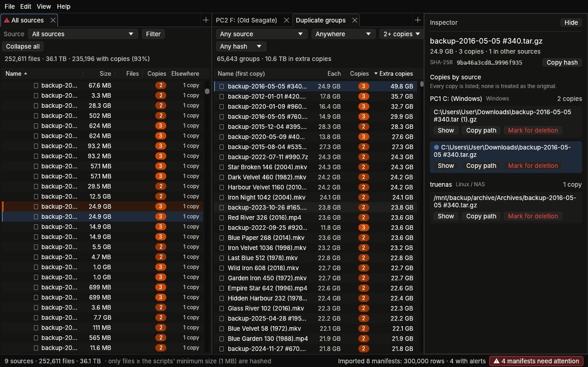
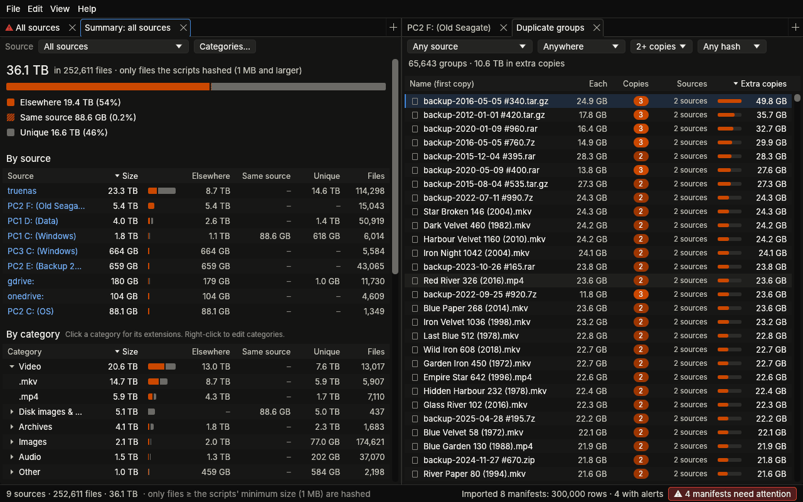
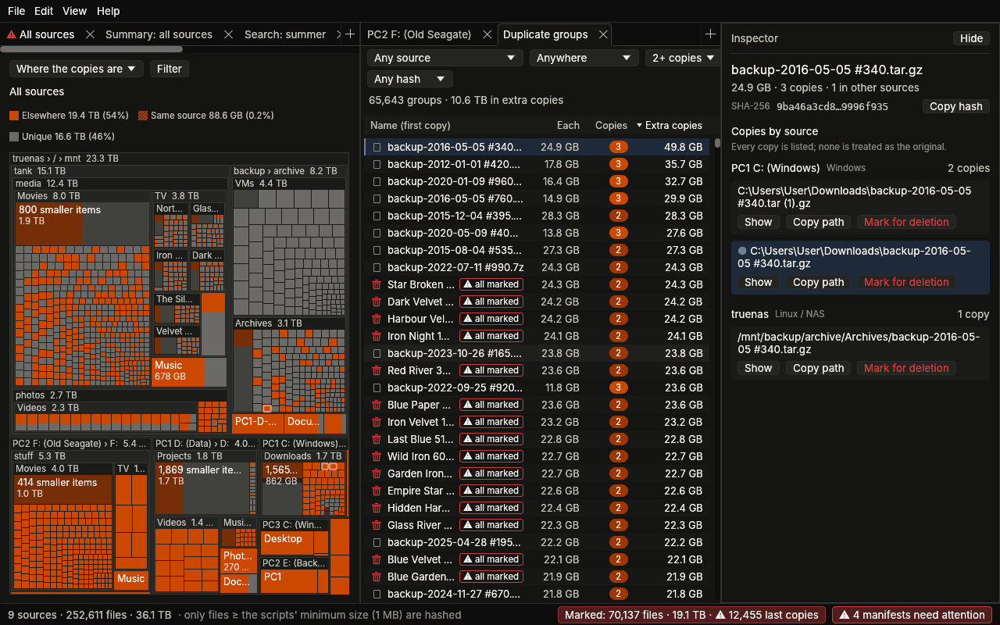
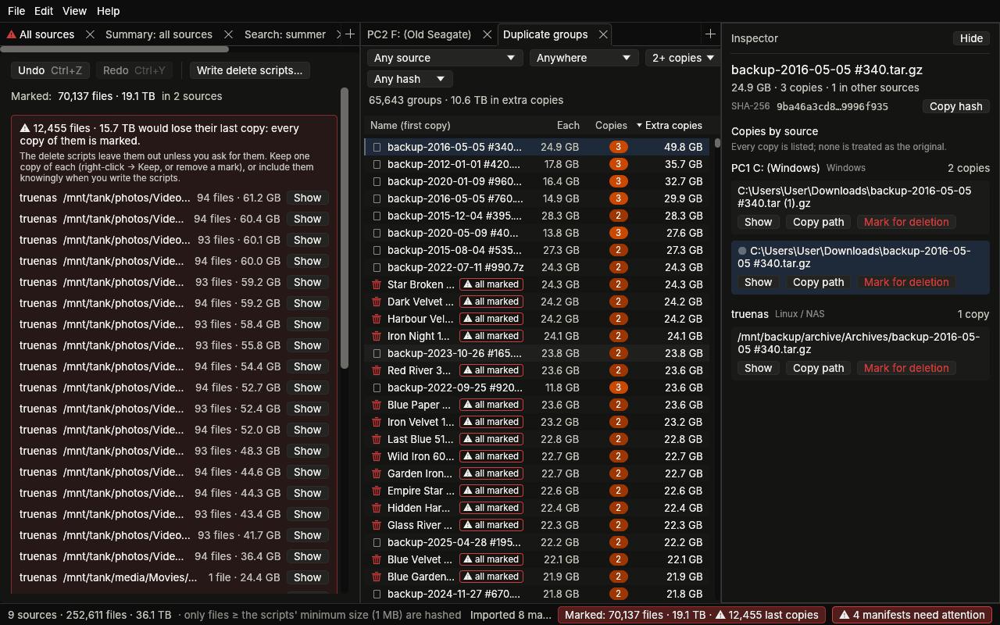

# DupeMap

Find duplicate files across computers, USB drives, a NAS and cloud storage, from hash
manifests.

Each place is scanned into a manifest: one line per file with its SHA-256, size, source and path.
DupeMap scans this PC itself and writes scripts for the other computers. It imports every
manifest into one database and shows where each file's copies are and how much space the extra
copies take. You mark what should go, and DupeMap writes a delete script for each source, which
you check and run there. It is a Windows desktop app written in Rust. It works offline and never
deletes anything itself.



## Quick start

1. **Get `DupeMap.exe`**: build it (see [Building](#building-from-source)) or take it from the
   `dupemap-windows-x64` artifact of a CI run.
2. **Scan this PC**: on the start screen, *Scan this PC*. Tick the drives (this computer's, USB,
   network) and DupeMap hashes them, importing each drive as it finishes.
3. **Scan the other computers**: *Scan another computer* saves a script for Windows or Linux
   (TrueNAS SCALE, a Linux PC). Run it there as administrator / root, then drop the manifest it
   writes onto DupeMap's window. For cloud drives, import a checksum list from `rclone hashsum`
   (see [Checksum lists](#getting-the-data-in)).
4. **Look around**:
   * *Duplicate groups* (Ctrl+G) lists every set of identical files, with the most space taken
     by extra copies first.
   * The *inspector* lists every copy of the selected file.
   * *Summary by file type* (Ctrl+U) shows what is duplicated and where.
   * *Search* (Ctrl+F) finds files by name or hash.
5. **Clean up**:
   * Mark folders or files for deletion (right-click, or Del) and check the *Marks* tab (Ctrl+M)
     for files that would lose their last copy.
   * Write the delete scripts, run each one with `-DryRun` / `--dry-run` first, then for real.

## Getting the data in

* **Scan this PC** (start screen, File → Scan this PC…): tick *This computer's drives*, *USB
  drives* and/or *Network drives* (each drive can be ticked on its own too). DupeMap hashes their
  files one drive after another, the same way the export script does, and imports each drive's
  manifest as it finishes.
  * Progress, speed and time left are shown. *Stop* keeps what was hashed; the next scan of that
    drive continues from there, also after a crash or power cut.
  * Without administrator rights, folders only an administrator can read are skipped, so the
    window offers *Restart as administrator* (Windows asks first; DupeMap opens again with the
    window). Drive letters mapped in your normal session are not visible to a program run as
    administrator; DupeMap then reaches those network drives through their share and still writes
    their paths with the letter.
  * Like the scripts, it skips Windows, Program Files, ProgramData, AppData, the recycle bin and
    (unless you untick it) OneDrive / Google Drive folders. It never reads online-only cloud files,
    since that would download them. It hashes files of 1 MB and up (adjustable).
  * It reads a spinning or USB disk one file at a time and an SSD with up to four, and keeps the
    computer awake.
  * Manifests go to a `scans` folder beside the database, one per drive
    (`manifest-<PC>-<letter>.tsv`). They use the scripts' source names (`<PC> D: (<label>)`), so a
    drive scanned here and by a script is one source.
* **Scan another computer** (start screen, File → Scan another computer…): choose Windows or Linux
  and tick the same boxes, then save the script. Run it there with administrator rights:
  * Windows: right-click → *Run with PowerShell* (it asks for administrator rights itself).
  * Linux: `sudo bash dupemap-scan-linux.sh` (or under `nohup` for a long run).

  Then import the manifest it writes. Run again, it continues where it stopped. On Linux it scans
  each file system on its own (ZFS datasets, USB disks by their bus, NFS/SMB shares). It skips
  `.zfs` snapshots, the system folders of the system disk, TrueNAS's boot pool and system dataset,
  and app data.
* **Import**: File → Import manifests (Ctrl+O), or drop manifests, checksum lists or a folder of
  them anywhere on the window. Importing a file with the same name replaces the earlier import.
  An import report opens afterwards. Alerts (non-SHA-256 hashes, malformed lines) stay visible in
  the status bar and as a ⚠ on the source's tab until you dismiss them (File → Manifests →
  Report).
* **Checksum lists** (`hash  path` per line, as `sha256sum` or `rclone hashsum sha256` write them;
  for example the OneDrive list from `rclone hashsum sha256 --download onedrive:`) are recognised
  and imported after a short question.
  * It asks which source the files are on and where their relative paths start. The source is
    guessed from the file name: `onedrive-hashsum.txt` → the rclone remote `onedrive:`.
  * A size list (`size<TAB>path`, as `rclone lsf --format sp` writes it) fills in sizes;
    `onedrive-sizes.tsv` next to the list is picked up by itself. Without one, a file takes the
    size of a copy with the same SHA-256 elsewhere. A file with no such copy shows its size as `?`
    and counts as 0 bytes.
  * Re-importing the list uses the same answers.
* **Manifests** (File → Manifests): every import with its rows and alerts. *Open folder* shows the
  manifest file; *Remove* takes a manifest out again (and restores anything it had replaced).

## Exploring

* **Tabs**: every tab shows all sources or one (the Source box above the table). Add tabs with `+`
  or Ctrl+T, drag a tab to the side of another to split the view, close with ×.
* **Columns**:
  * *Size*: the bar is the share of the parent folder; its colour is the absolute size (darker blue
    = smaller, log scale 1 MB → 100 GB).
  * *Files*: files in the folder.
  * *Copies*: for a file, every copy anywhere including itself (pill colour: 2, 3, 4–5, 6+); for a
    folder, how many of its files have another copy.
  * *Elsewhere*: for a file, copies in **other** sources; for a folder, the share of its bytes that
    also exist outside it (✔ all = every file has a copy outside).

  Unique files are dimmed. Click a column header to sort by it (again to reverse; numbers sort
  largest first). *Copies* sorts folders by how many of their files have a copy, *Elsewhere* by the
  share of their bytes also found outside them. Drag header edges to resize. A narrow tab drops
  columns to keep the names readable (Files first, then Copies, then Elsewhere); the inspector and
  tooltips still show everything.
* **Inspector** (the panel on the right, Ctrl+I):
  * Select a file and it lists **every copy**, grouped by source, with its path. *Show* opens that
    copy in a tab (expanding the folders and scrolling to it), next to *Copy path* and *Show in
    Explorer* for files on this PC. No copy is called the original: which ones to keep is your
    decision.
  * Select a folder and it shows how much of it has a copy outside it and which sources hold
    those copies. In each source it names the folder holding (nearly) all of them, with *Show* to
    jump there.
* **Linked highlighting**: while a file is selected, every copy of it is shaded orange in every
  tab. The folders leading to those copies get a fainter shade with a thin orange mark, so
  collapsed folders show where to look. While a folder is selected, the folders holding its copies
  are marked the same way.
* **Filter** (button above each table; every tab has its own): *Unique*, *With copies*, *With a
  copy in another source*, *With no copy in another source* (only on its own machine or drive),
  *Missing from* a chosen source (what that source lacks), and *SHA-256 only* / *Not SHA-256
  (flagged)*. Folder sizes and counts then add up the matching files only. ✕ clears the filter.
* **Duplicate groups** (View → Duplicate groups, Ctrl+G): every set of identical files, with the
  most space in extra copies first (extra copies = every copy beyond one).
  * Narrow it to groups with a copy on a chosen source, groups within one source or across
    sources, 3+ copies, or flagged hashes.
  * Click a column header to sort by size of each copy, copies, sources or extra copies.
  * Selecting a group lists its copies in the inspector; double-click or Enter opens the first
    copy in a tab.
* **Summary by file type** (View → Summary by file type, Ctrl+U, or right-click a source): the
  total size of a source, or of all of them, split three ways:
  * *Elsewhere* (solid orange): the file has a copy in another source.
  * *Same source* (striped orange): it has copies, but only within its own source.
  * *Unique* (grey): the only copy anywhere.

  The same split follows by source (click one to summarise it), by category (click a category to
  see its extensions) and by extension. Every column sorts.

  
* **Treemap** (View → Treemap, or right-click a folder → *Show as treemap*): what a folder, a
  source or every source holds, as rectangles sized by their bytes, nested folder in folder.
  * Colours: *Where the copies are* (as the summary: orange elsewhere, striped orange in the
    same source, grey unique), *File type* (the first eight categories in their colours, the rest
    grey) or *Marked for deletion* (marked, last copy marked, not marked). A box holding several
    kinds is split into bands, and the legend gives the bytes of each colour.
  * Hover for the path, size and split; click to select (the inspector shows it, and its copies
    are outlined in orange wherever they are, or the box hiding them); double-click or Enter
    zooms into a folder, Backspace or the trail above goes back up.
  * Right-click for the same marking and other actions as in a tree; Del marks or unmarks.
  * Items too small to draw are grouped into one dimmed "N smaller items" box per folder;
    zoom in to see them. A folder that holds just one folder shares its header with it
    (`truenas › / › mnt`). The tab's filter applies: with *With a copy in another source* the
    boxes show where the reclaimable space is.

  
* **File type categories** (View → File type categories…, or *Categories…* in a summary): a
  category is a list of extensions. Rename, reorder, add or remove categories, edit their
  extensions, or pick from the largest extensions that are in no category yet ("Other").
  Right-click an extension in a summary to count it under another category. The categories are
  saved in the database. *Restore defaults* brings back the built-in list: video, audio, images,
  documents, archives, disk images & backups, software, development, databases and game data.
* **Search** (View → Search, Ctrl+F): files and folders in every source (or one), by name or by
  hash.
  * By name: part of a name, with case and accents ignored (`plaza` finds `Plaża`), or a
    whole-name pattern with `*` and `?` (`*.mkv`, `IMG_20??.jpg`).
  * By hash: paste a SHA-256 (or type its first digits; `md5:…` for other hashes) to find every
    copy.

  Results sort by name, folder, source, size or copies. Select one to see it in the inspector;
  double-click to show it in a tab.
* **Ignored folders** (File → Ignored folders): folders matching a rule are left out completely.
  They are not shown, not counted, and their files never count as copies.
  * Ignored out of the box: Windows system folders, Program Files, ProgramData,
    `$Recycle.Bin`-style folders, AppData and ZFS `.zfs` snapshot folders. `node_modules`, `.git`
    and `__pycache__` are offered switched off.
  * Add your own folders or patterns, for every source or just one: `D:\Games\Steam`, `?:\Temp`
    (any drive), `**\node_modules` (anywhere), `/mnt/tank/.recycle`, `gdrive:/Trash`. Matching
    ignores case.
  * Changes apply when you press Apply: the index is rebuilt; nothing is re-imported.
* **Right-click** a folder or file to copy its path or name, show it in Explorer (for paths on
  this PC), expand or collapse everything below it, ignore the folder, mark it for deletion, or
  open *Show every copy* / *Where are the copies?* in the inspector.

## Cleaning up



* **Marking for deletion**: right-click a folder or file (in a tree, the search results or the
  inspector's list of copies) and choose *Mark for deletion*, or press Del on the selected row.
  * A folder can be marked whole, or only *its files that have a copy outside it*. *Keep* makes
    an exception inside a marked folder.
  * The most specific mark decides: a file's own mark beats its folder's, and a deeper folder
    beats a shallower one.
  * Marked files are struck through with a bin in every tab, and a folder with marks below it
    shows a small bin. The duplicate groups say how many copies of each file are marked.
  * A file of which **every copy is marked** would be gone for good. It is flagged "⚠ last copy"
    everywhere and left out of the scripts unless you ask for it.
  * Marks are saved in the database by source and path, so they survive re-importing. Edit →
    Undo / Redo (Ctrl+Z / Ctrl+Y).
* **Marks tab** (Edit → Marked for deletion, Ctrl+M, or the *Marked* total in the status bar):
  how much is marked, the folders holding last copies, and every mark per source with what it
  marks, *Show* and ✕.
* **Delete scripts** (File → Write delete scripts…, or in the Marks tab). **DupeMap never deletes
  anything itself**: it writes one script per source, which you run on the computer that has
  those files, plus a plain list of the paths if you like.
  * Windows drives (PowerShell): files go to the Recycle Bin, into a `_DupeMap deleted\<date>`
    folder at the top of the drive, or are deleted for good. The script checks the drive's label
    first (a USB drive may have another letter: `-Drive G:`) and handles paths over 260
    characters. On network drives and USB sticks, which have no Recycle Bin, it moves files
    instead.
  * Linux / TrueNAS (bash): files go into `_dupemap_deleted/<date>` at the top of each file system,
    or are deleted for good with `rm`. On ZFS that folder is in the dataset; no space is freed
    until you delete it, and snapshots hold the space until they go. The script runs only on the
    computer of that name and works with names that are not UTF-8. It leaves alone links and files
    with other hard links (removing those frees nothing).
  * Cloud drives (PowerShell with rclone): `rclone delete`, into the trash / recycle bin by default.
  * Every script first checks each file (still there, same size, optionally the same SHA-256).
    It shows what it will do and asks you to type YES. `-DryRun` / `--dry-run` only shows. A log
    of everything is written next to the script.

## Keyboard shortcuts

Help → Keyboard shortcuts (F1) shows them in the app too.

| keys | anywhere |
|---|---|
| Ctrl+O | import manifests |
| Ctrl+F | search by name or hash |
| Ctrl+G | duplicate groups |
| Ctrl+U | summary by file type |
| Ctrl+M | marked for deletion |
| Ctrl+I | show or hide the inspector |
| Ctrl+T | new tab |
| Ctrl+Z / Ctrl+Y (or Ctrl+Shift+Z) | undo / redo a change to the marks |
| F1 | the shortcuts |
| Ctrl+Q | quit |

| keys | in a tree |
|---|---|
| ↑ ↓ PgUp PgDn Home End | move |
| → | expand a folder, or go into it |
| ← | collapse a folder, or go to the parent |
| Enter or Space | expand or collapse |
| Ctrl+C | copy the path |
| Del | mark or unmark for deletion |

In search results and duplicate groups, the same keys move; Enter shows the file in a tab (the
first copy of a group), and Del marks or unmarks a search result. In the treemap, double-click or
Enter zooms into the selected folder (a file: shows it in a tab), Backspace goes up one level and
Del marks or unmarks.

## Files, options and the session

* **The database** lives in `%LOCALAPPDATA%\DupeMap\dupemap.db`; `DupeMap.exe --db D:\other.db`
  uses another one. Help → *Open data folder* shows it in Explorer. Beside it are:
  * the saved session (`dupemap.session.json`);
  * `scans`, the manifests of this PC's scans;
  * `delete-scripts`, the scripts DupeMap wrote, one folder per time.

  Help → *About DupeMap* shows the paths, the database size and what the index holds.
* **Your session is kept.** The app saves what you had open, about a second after every change,
  and restores it at the next start:
  * the tabs and how they are split;
  * per tab: the source, sort, filters, expanded folders, selected row and scroll position;
  * the inspector (open or not, its width and what it shows);
  * the window (size, position, maximised).

  The file is written to a temporary file and swapped in, with a `.bak` copy of the previous one,
  so a crash or power cut leaves the last good one. Folders and files are remembered by database
  id, so re-importing does not lose your place; anything that no longer exists is skipped. View →
  Reset layout starts again with one tab. `--reset-session` deletes the saved session at startup,
  for example if a window was left on a monitor you unplugged.
* **One DupeMap per database**: starting it again brings the open window to the front instead of
  opening a second one, which would overwrite the first one's session and marks. With
  `--db` another database opens alongside.
* **Command line**:
  * `--db <file>`: use another database.
  * `--demo <rows>`: fill the database with generated demo data (use a separate `--db`).
  * `--window 1024x768`: open the window at that size, to try small screens; it overrides the
    saved window size.
  * `--scan`: open *Scan this PC* at start.
  * `--reset-session`: start with one tab.
* **Graphics**: the app draws with OpenGL 3, which every GPU driver of the last decade provides.
  In a virtual machine or remote session without GPU drivers, copy `opengl32.dll` and
  `libgallium_wgl.dll` from a [Mesa for Windows](https://github.com/pal1000/mesa-dist-win/releases)
  build (x64 folder) next to `DupeMap.exe`; that is how the CI runner, which has no GPU, runs it.
* **Privacy**: the app only reads files (manifests, and the drives you scan). It has no network
  access and no telemetry, and it never deletes anything: deleting is done by the scripts it
  writes, when you run them.

## Performance

Measured with `dupemap-bench` on 5 million generated rows (4.2 million files once overlapping
scans are folded together, 1.4 million distinct contents) on a cloud VM. A PC with an SSD should
be in the same range.

| step | time / size |
|---|---|
| import all manifests | 32 s (about 155,000 rows a second), at most 430 MB of memory |
| database on disk | 720 MB (about 150 bytes a row) |
| open the database and build the index | 3 s |
| memory of the app itself, after a search (Windows also caches the database file) | about 470 MB |
| list a folder of 73,000 files | 0.15 s |
| duplicate groups: first page / sorted by size of each copy | 0.02 s / 0.18 s |
| search by name / by hash | 0.15–0.8 s / a few milliseconds |
| treemap of every source / of the biggest one (about 8,000–10,000 boxes) | 0.04 s / 0.02 s |
| remove a manifest of 1 million rows (and restore what it replaced) | a few seconds |

Every CI run posts the same benchmark on 1 million rows on a Windows runner in its pull request.

## Manifest rules

* Format: UTF-8 (BOM allowed; UTF-16 is decoded too), tab-separated, header
  `hash<TAB>size<TAB>host<TAB>path`, CRLF or LF.
* Hashes must be 64 hex characters (SHA-256). `sha256:<hex>` is accepted. Anything else
  (`quickxor:`, `md5:`, unprefixed MD5/SHA-1...) is **flagged**: imported, shown with an alert,
  and only ever matched against rows with the same algorithm.
* Lines with missing columns, a non-numeric size, an empty hash/host/path, or a path without a
  file name are **malformed**: skipped, counted and sampled with their line numbers.
* Each distinct `host` value is a source. Paths are split at their anchor: `D:\`,
  `\\server\share\`, `/`, or an rclone remote such as `gdrive:`. Windows names compare
  case-insensitively.
* Linux names that are not valid UTF-8 are shown with `�` and their exact bytes are kept.

## How duplicates are counted

* Two files are copies when algorithm, digest and size are all equal. A file from a checksum
  list has no size: it is a copy of the files with the same algorithm and digest, and takes
  their size.
* A path listed twice is one file, never two copies:
  * The same path twice in one manifest (overlapping scan folders) keeps one listing.
  * The same path in two manifests (for example a USB disk scanned by both Windows scripts) keeps
    one listing. It prefers SHA-256, then a listing with a size (over a checksum list's), then the
    newer scan (manifest file date), then the later import. Removing a manifest restores what it
    hid.
  * Cloud remotes are the exception: Google Drive allows identical names, so same-path rows there
    stay separate files.
* For every folder, under any filter, DupeMap counts the total size, the file count, the files
  with another copy anywhere, and the bytes and files whose content also exists **outside that
  folder**. "Fully duplicated elsewhere" means every file in the folder has a copy outside it.
* "Where the copies are" (inspector, for a folder) lists, per source, the bytes of the folder's
  files that have a copy there (outside the folder itself; a file can count for several sources).
  For each source it names the deepest folder holding copies of at least 90% of those bytes.

## Command-line tools

Next to the app, in `target\release\`:

```
dupemap-check C:\Hashes\manifest-*.tsv
dupemap-check --db C:\Hashes\dupemap.db C:\Hashes\manifest-*.tsv
```

`dupemap-check` imports manifests and prints a report.
* For each manifest: the rows imported and any alerts (non-SHA-256 hashes, malformed lines with
  line numbers and samples, duplicate listings, overlaps with other manifests).
* Then a summary for each source and the biggest duplicate groups with every location.

Exit code 1 means at least one manifest raised an alert. With `--db` the database is kept, and
re-running with a manifest of the same file name replaces the earlier import. Checksum lists are
recognised; `--source onedrive: --base onedrive: --sizes onedrive-sizes.tsv` say where they belong
(otherwise they are guessed from the file name).

```
dupemap-scan --list                    # drives and how they are classed
dupemap-scan --out C:\Hashes D: usb     # D: and every USB drive
dupemap-scan --folder E:\Photos --host "PC2 E: (Photos)" --out C:\Hashes
```

`dupemap-scan` is the built-in scan, from the command line.

```
dupemap-gen --out C:\tmp\gen --rows 1000000
dupemap-bench --rows 1000000
```

* `dupemap-gen` writes eight manifests that mimic three PCs, USB drives (scanned twice), a TrueNAS
  box with two pools, Google Drive and OneDrive. They include awkward names and deliberate bad
  lines, plus an `expected.json` describing what an import should report.
* `dupemap-bench` times importing, opening, browsing and searching on such data.

## Building from source

1. Install Rust with rustup from <https://rustup.rs> and choose the default MSVC toolchain. It
   installs the Visual Studio C++ build tools if they are missing; SQLite is compiled from source,
   so a C compiler is needed.
2. In this folder:

```
cargo test --release
cargo build --release
```

The programs end up in `target\release\`. `DupeMap.exe` carries its icon and version
information; no resource compiler is needed.

| path | what |
|---|---|
| `crates/core` | `dupemap-core`: manifest parsing and validation, SQLite storage, the in-memory duplicate index, search, marks and delete scripts, the built-in scan, the synthetic data generator. All logic lives here and is unit-tested. |
| `crates/tools` | `dupemap-gen`, `dupemap-check`, `dupemap-scan`, `dupemap-bench`. |
| `crates/app` | `DupeMap.exe`, the desktop app (egui). |

The tests include brute-force cross-checks of the index. To check real manifests end to end
(every path reproduced exactly, copy counts equal to a plain group-by of hash and size), point
the optional test at a folder of them; nothing is committed:

```
set DUPEMAP_REAL_MANIFESTS=C:\Hashes
cargo test --release --test real_manifests -- --nocapture
```
